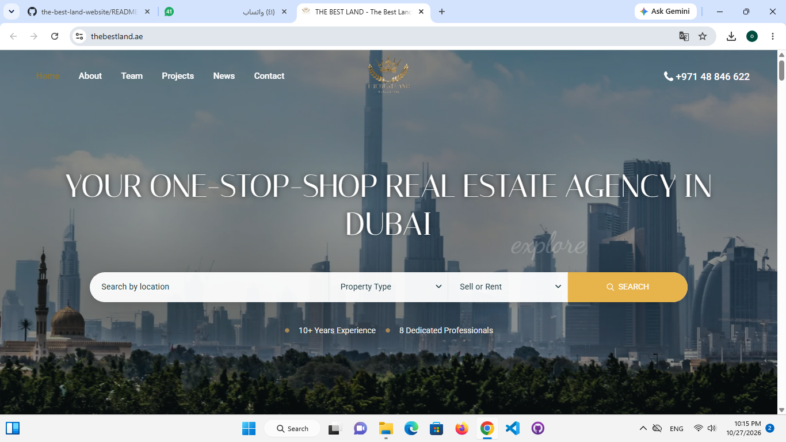
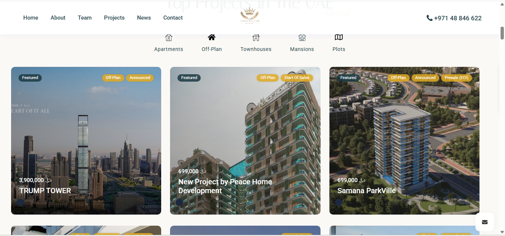
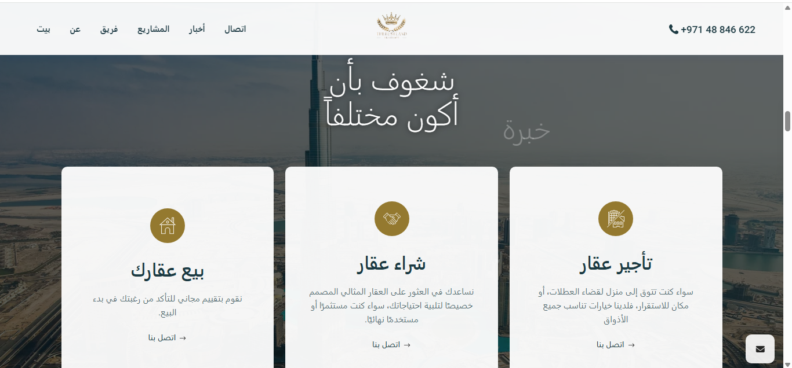
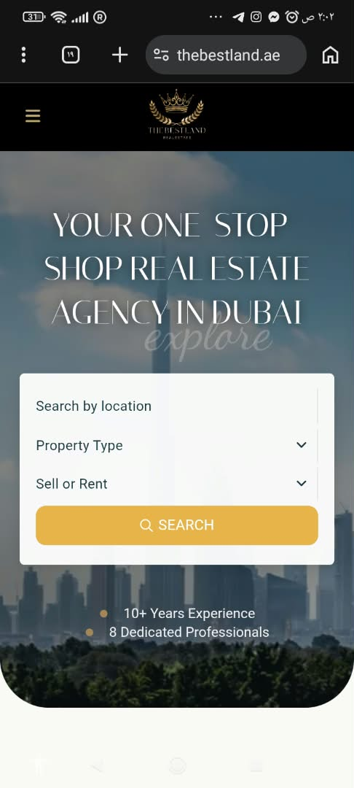

The Best Land — Real Estate Website

A real estate website project showcasing property listings, real estate services, and modern web interfaces.

🌐 Live Website

"Visit The Best Land" (https://thebestland.ae/)

📌 About the Project

The Best Land is a real estate website project focused on presenting property information through a clear, user-friendly, and professional web experience.

This project is showcased here as part of my web development portfolio.

✨ Key Features

- Property listings and information
- Real estate services presentation
- Clean and modern user interface
- User-friendly navigation
- Responsive website design

🛠️ Technologies
## 🖼️ Project Preview

### Homepage

### Properties

### Services

### Mobile View

Technologies used in this project include those applied during development.

<!-- Add only the technologies you personally used -->🖼️ Project Preview

Screenshots of selected website interfaces will be displayed here.

<!-- Add your image links below -->🔒 Source Code & Confidentiality

The source code is not publicly available due to client confidentiality. This repository is intended to showcase selected project information and visual previews for portfolio purposes.

👨‍💻 Developer

Web Developer | Website Design & Development
